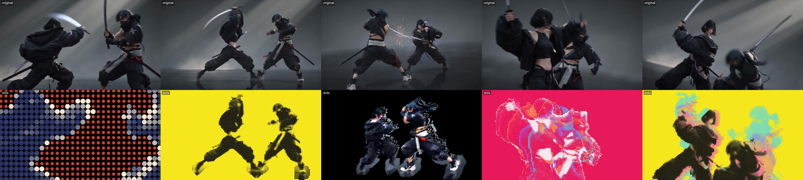
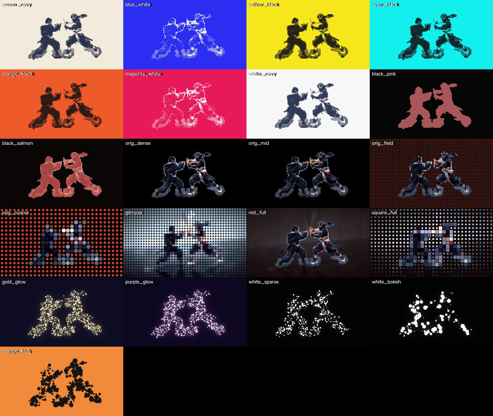

# dotkit · 点之战

把一段人物视频（打斗、舞蹈、动作片段）做成**按音乐节拍切换的点阵风短片**：人物变成点阵，每拍换一种点的画法，重拍时点被压扁、炸向镜头，中间定格后镜头绕着三维点云转。

*Turn a video of people in motion into a beat-synced dot-matrix short: halftone / silhouette / glowing-particle looks switching on the beat, dots squashing and exploding toward the lens on hits, and a freeze-frame orbit around a 3D point cloud. One command, pure Python.*



灵感来自 [@aicreataro《点之战》](https://x.com/aicreataro/status/2106236856979607569)。本仓库不包含原作的任何画面，是照着它的风格从零实现的。

## 一条命令出片

```bash
git clone https://github.com/mixx993/dotkit.git && cd dotkit
python3 -m venv .venv && .venv/bin/pip install -e .
.venv/bin/dotkit doctor            # 检查环境
bash tests/smoke.sh                # 冒烟测试，约 1 分钟，看到 SMOKE OK

.venv/bin/dotkit auto 你的视频.mp4 --out pieces/我的片子
```

输出在 `pieces/我的片子/`：

| 文件 | 内容 |
|---|---|
| `dots.mp4` | 成片 |
| `compare.mp4` | 上原画、下点阵的同屏对照 |
| `edit.py` | 剪辑脚本，每段一行，改完 `python edit.py` 重新渲染 |
| `beats.json` | 测出来的拍点和重拍 |

另配音乐：`--audio 音乐.mp3`。只看段落安排、先不渲染：`--plan-only`。

**需要：** Python 3.10+、ffmpeg。第一次处理素材会从 Hugging Face 下载约 300MB 模型。Apple Silicon（MPS）和 NVIDIA（CUDA）上预处理约 0.5 秒 / 帧，纯 CPU 约 3–6 秒 / 帧；渲染 15 秒片子约 1 分钟。

**什么素材效果好：** 1–2 个人、动作幅度大、背景简单、5–20 秒。AI 生成（Seedance / 即梦 / Kling）的打斗片段最合适。

## 用 AI agent 来做

仓库自带给 agent 的说明，打开仓库直接说「把这段视频做成点阵风」就行：

| Agent | 读什么 |
|---|---|
| OpenAI Codex、Cursor、Gemini CLI、GitHub Copilot 等 | `AGENTS.md` |
| DeepSeek Harness（dsh） | `AGENTS.md` + `.agents/skills/dotkit/SKILL.md` |
| Claude Code | `CLAUDE.md` + `.claude/skills/dotkit`（链接到同一份 SKILL.md） |

想在别的项目里也能用，把 `.agents/skills/dotkit/` 复制到 `~/.agents/skills/`（dsh）或 `~/.claude/skills/`（Claude Code），并在 SKILL.md 里把命令路径改成你装 dotkit 的位置。

## 文档

- [docs/STYLE.md](docs/STYLE.md)：风格拆解。段落模板、look 词典、打击事件、为什么这样实现、按素材调整的规则
- [docs/EDITING.md](docs/EDITING.md)：改 `edit.py` 的参数参考
- [examples/ninja_edit.py](examples/ninja_edit.py)：一条手工精修过的剪辑脚本



## 命令

```bash
dotkit auto    VIDEO [--audio A] [--out DIR]   # 预处理 → 测节拍 → 生成剪辑脚本 → 渲染 → 对照版
dotkit prep    VIDEO OUT [--mask key] [--depth flat]   # 帧 + 人物遮罩 + 深度
dotkit beats   AUDIO OUT.json                  # 拍点 / 半拍 / 重拍
dotkit looks   SRC_DIR [--frame N] [--levels]  # 所有 look 画在同一帧上
dotkit compare ORIGINAL PROCESSED OUT          # 上下同屏对照
dotkit doctor                                  # 环境检查
```

`--mask key --depth flat`：纯色背景的素材可以不用模型（快，但不能转机位）。

## 技术栈

| 环节 | 用的东西 |
|---|---|
| 人物遮罩 | [Mask2Former](https://huggingface.co/facebook/mask2former-swin-small-coco-instance)（COCO 人物类） |
| 深度 | [Depth Anything V2 Small](https://huggingface.co/depth-anything/Depth-Anything-V2-Small-hf) |
| 节拍 | librosa |
| 渲染 | numpy（三维点云、投影、炸开）+ OpenCV（抗锯齿画点、模糊、合成） |
| 出片 | ffmpeg |

## 许可

- 代码：[MIT](LICENSE)。
- 模型在运行时从 Hugging Face 下载，不随仓库分发：Depth Anything V2 **Small** 是 Apache-2.0（注意 Base / Large 是非商用许可，dotkit 只用 Small）；Mask2Former 代码是 MIT，权重在 Hugging Face 上标注为 `other`，商用前请自行确认。
- `docs/img/` 里的示例图来自作者用 AI 生成的素材。
